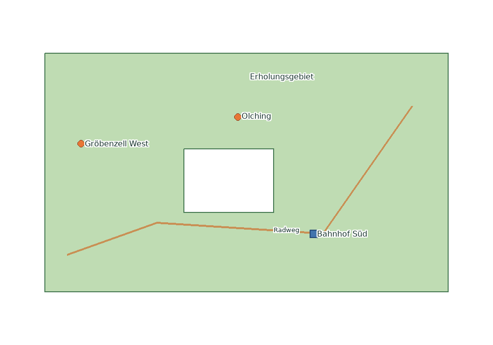

# Pure PHP WMS

A configuration-driven **OGC Web Map Service (WMS) 1.3.0** written in PHP 8.2+ for Apache hosting. Publish your own Shapefile, GeoJSON or GeoPackage vector data as georeferenced **PNG maps** without MapServer, GDAL, Node.js, a database server or a background process.

Georeferencing is supplied by the WMS request's `CRS`, `BBOX`, `WIDTH` and `HEIGHT`; the returned PNG itself is **not** a GeoTIFF.



**Documentation:** [Installation and deployment](INSTALLATION.md) · [Full configuration and symbology reference](docs/CONFIGURATION.md) · [Validation and limitations](docs/VALIDATION.md) · [OGC reference review](docs/OGC_REFERENCE_REVIEW.md) · [Changelog](CHANGELOG.md)

## 1. What the server does

| Area | Current support |
|---|---|
| WMS operations | `GetCapabilities`, `GetMap`, `GetFeatureInfo` (WMS **1.3.0 only**, HTTP GET) |
| Additional operation | `GetLegendGraphic` for configured local styles; not a full SLD service |
| Vector sources | ESRI Shapefile/DBF, GeoJSON FeatureCollection, GeoPackage simple-feature vector tables |
| Geometry | Point, line, polygon (including holes), multipart geometry and supported GeometryCollections |
| Projection | `EPSG:4326`, `CRS:84`, `EPSG:3857`, `EPSG:25832`, `EPSG:25833` |
| Output | PNG, transparent or solid background, selected layer order; feature information in GeoJSON-compatible JSON or plain text |
| Symbology | Fills, strokes, transparency, point shapes, local PNG icons, reusable named styles, per-attribute rules |
| Labels | Local TrueType fonts, UTF-8 text, color, halo, simple collision avoidance and scale limits |
| Performance | One SQLite database/RTree per dataset, bounded file cache, revision-aware invalidation, concurrent-render limits |
| Administration | Human-editable JSON; an explicit CLI import step; no public upload endpoint or web admin |

**Not supported:** raster/GeoTIFF layers, WFS/WMTS, remote sources, SLD uploads, arbitrary EPSG definitions, JPEG maps, curve geometries, antimeridian or polar processing. This is a **regional, resource-bounded vector map service**, not a replacement for a full-featured GIS server. It is **not OGC certified**; see [the actual tests and remaining checks](docs/VALIDATION.md).

## 2. Requirements and download

- Apache 2.4 and **64-bit PHP 8.2 or later**.
- PHP extensions: **GD with FreeType**, **PDO_SQLite with SQLite RTree**, **XMLWriter**, **mbstring**, **iconv**.
- Recommended hosting limits: `memory_limit=256M` or more and `max_execution_time` at least 20 seconds for map requests. Actual requirements depend on your data.
- A complete **distribution ZIP** contains `vendor/` and pre-imported sample SQLite databases. **Composer and SSH are not required on the hosting account** for the packaged demo.
- If you **clone the source repository**, install the locked dependencies using Composer locally first: `composer install --no-dev --prefer-dist`. Do not assume that a Git checkout includes `vendor/`.
- PHP CLI is needed **somewhere** (on your computer or server) for importing your own data. The actual website requires only normal Apache/PHP request handling.

On a computer with PHP CLI, check prerequisites from the project directory:

```sh
php bin/console.php doctor
php bin/console.php validate
php bin/console.php list
```

The first command checks extensions, fonts, SQLite RTree and directory permissions. The second validates service/style/source configuration; the third reports published dataset metadata.

## 3. Installation in five steps

1. Extract the distribution ZIP (or clone and run Composer locally).
2. Edit **`config/server.json`** and set `base_url` to the actual public `wms.php` address, **without a query string**.
3. Deploy to Apache. **Preferred:** make `public/` the site's DocumentRoot. **FTP-only alternative:** upload the entire project under a fixed webroot with **both** `.htaccess` files; verify that private folders are denied.
4. Ensure the running PHP user can write to `cache/`. It needs no write access to configuration or dataset files during normal map requests.
5. Open `https://example.org/wms/public/wms.php?MAP=demo&SERVICE=WMS&REQUEST=GetCapabilities&VERSION=1.3.0` and check that the response is XML. Then request the sample map below.

The URL above assumes the **FTP-only layout**, where the project is in the `wms/` subdirectory. With `public/` as DocumentRoot, use `https://maps.example.org/wms.php` instead. Always adjust `config/server.json` accordingly.

**Security verification is mandatory:** for FTP-only deployment, `/wms/config/server.json` and `/wms/data/places.sqlite` must respond **403 or 404**, never expose their content. If your host ignores `.htaccess`, use the preferred DocumentRoot layout; do not deploy private directories openly.

For Windows, FTP hosting, file permissions, safe dataset replacement, troubleshooting and a detailed walkthrough, read **[INSTALLATION.md](INSTALLATION.md)**.

## 4. Try the included demo

The demonstration contains **synthetic** land, routes and places data around western Munich, not official data.

**WMS endpoint (for QGIS):**

```text
https://example.org/wms/public/wms.php?MAP=demo
```

**Capabilities:**

```text
https://example.org/wms/public/wms.php?MAP=demo&SERVICE=WMS&REQUEST=GetCapabilities&VERSION=1.3.0
```

**PNG map:**

```text
https://example.org/wms/public/wms.php?MAP=demo&SERVICE=WMS&VERSION=1.3.0&REQUEST=GetMap&LAYERS=land,routes,places&STYLES=&CRS=CRS:84&BBOX=11.28,48.18,11.39,48.245&WIDTH=1000&HEIGHT=700&FORMAT=image/png&TRANSPARENT=TRUE
```

**Single-layer legend:**

```text
https://example.org/wms/public/wms.php?MAP=demo&VERSION=1.3.0&REQUEST=GetLegendGraphic&LAYER=places&FORMAT=image/png
```

**Feature information at a map pixel** (adjust `I`/`J` to the feature you clicked):

```text
https://example.org/wms/public/wms.php?MAP=demo&VERSION=1.3.0&REQUEST=GetFeatureInfo&LAYERS=land,routes,places&STYLES=&CRS=CRS:84&BBOX=11.28,48.18,11.39,48.245&WIDTH=1000&HEIGHT=700&FORMAT=image/png&QUERY_LAYERS=places&I=500&J=350&INFO_FORMAT=application/json&FEATURE_COUNT=5
```

The last request might return an empty FeatureCollection when there is no feature at that pixel.

**Important axis order in WMS 1.3.0:** `CRS:84` uses `longitude,latitude`, while `EPSG:4326` uses `latitude,longitude` **for the BBOX parameter**. To express the demo extent with EPSG:4326, use `BBOX=48.18,11.28,48.245,11.39`. **Source GeoJSON coordinates** remain `longitude,latitude` in either case.

## 5. Use the WMS in QGIS

1. In QGIS open **Data Source Manager → WMS/WMTS → New** (menu names may differ by version).
2. Set the URL to `https://example.org/wms/public/wms.php?MAP=demo` and give the connection a name.
3. Click **Connect**, select `land`, `routes` or `places`, then **Add**.
4. Choose one of the CRS values advertised by the service and PNG output.
5. Use the **Identify Features** tool on a queryable layer to retrieve only explicitly allowed attributes.
6. If you define multiple styles for a layer, select the preferred advertised style in QGIS or request it using `STYLES`.

Clients control the layer drawing order via `LAYERS=land,routes,places`: land is drawn first, then routes, then places. `STYLES=` selects each layer's default style. For multiple layers, nonempty `STYLES` must contain exactly one comma-separated entry per layer; empty entries mean default.

## 6. Add your own data, layer and service: complete example

The key distinction is:

- **Source**: an original file described in `config/sources.json`.
- **Dataset**: the **imported** `data/<source-name>.sqlite` file, generated by the CLI.
- **Style**: a reusable JSON file under `config/styles/`.
- **Layer**: a named entry in a service that ties a dataset to one or more styles and permitted query fields.
- **Service**: one `config/services/<service-name>.json` file, selected through the `MAP` URL parameter. A service may contain multiple layers; datasets and styles may be reused.

**Step A — prepare the file.** Put these matching Shapefile components in `sources/`:

```text
sources/protected_areas.shp
sources/protected_areas.shx
sources/protected_areas.dbf
sources/protected_areas.prj
sources/protected_areas.cpg
```

Make sure the data really uses EPSG:25832 and the DBF text encoding is Windows-1252. The importer **does not automatically interpret** `.prj` or `.cpg`; you explicitly declare CRS/encoding. Alternatively, export GeoJSON as **EPSG:4326** or select a vector table from a GeoPackage. Shapefiles are read **one record at a time**, up to the **256 MiB source-file limit**. Memory depends mainly on the current feature, not the total SHP size. A feature remains limited to 20,000 vertices and 1 MiB geometry JSON; split or simplify larger individual features in your GIS.

**Step B — register the source.** Add this entry to the *existing* top-level object in `config/sources.json`, retaining any other sources:

```json
{
  "protected_areas": {
    "file": "protected_areas.shp",
    "crs": "EPSG:25832",
    "encoding": "Windows-1252"
  }
}
```

This illustrates the complete file for **one source only**. If the file already has `land`, `routes` or `places`, **merge** this entry with them; do not overwrite them by accident.

**Step C — import locally** and inspect metadata:

```sh
php bin/console.php import protected_areas
php bin/console.php list
```

The importer writes `data/protected_areas.sqlite` with a spatial RTree index and a new revision. It publishes only after a successful import; an unsuccessful import does not replace the previous dataset. Original source files remain unchanged.

**Step D — create `config/styles/protected_area.json`:**

```json
{
  "title": "Protected areas",
  "legend_geometry": "polygon",
  "fill": "#75b76b70",
  "stroke": "#2b6933",
  "stroke_width": 2,
  "label_field": "NAME",
  "font_size": 12,
  "label_color": "#173d20",
  "halo_color": "#ffffff",
  "halo": 2
}
```

`NAME` is an example attribute name and is **case-sensitive**. Use the actual field name in your source data, or omit `label_field` if you do not need labels.

**Step E — create `config/services/environment.json`:**

```json
{
  "title": "Environmental maps",
  "abstract": "Protected areas and related vector layers",
  "layers": {
    "protected_areas": {
      "title": "Protected areas",
      "dataset": "protected_areas",
      "styles": ["protected_area"],
      "queryable": true,
      "query_fields": ["NAME", "TYPE"]
    }
  }
}
```

The exact `query_fields` list is an **attribute allowlist** for `GetFeatureInfo`. Do **not** put confidential data into those fields or into map labels. Feature geometry is also returned in JSON feature-info responses. To add a second layer, add a second property under `layers`, pointing to its imported dataset and named styles. To create another separate WMS service, add another JSON file under `config/services/`, then choose it with `MAP=<filename-without-.json>`.

**Step F — validate and deploy:**

```sh
php bin/console.php validate
```

Upload the changed `config/sources.json`, `config/services/environment.json`, `config/styles/protected_area.json` and `data/protected_areas.sqlite`. You do **not** need to upload original source files to the web host after a local import.

**New WMS connection:** `https://example.org/wms/public/wms.php?MAP=environment`.

Detailed variants for GeoJSON, GeoPackage, sharing datasets, hot replacement and permission checks are in [INSTALLATION.md](INSTALLATION.md).

## 7. Symbology and classification: practical examples

Style files are regular UTF-8 JSON, reusable between layers. `fill` and `stroke` accept `#RRGGBB` or `#RRGGBBAA` (alpha `00` transparent, `ff` opaque). Widths and sizes are pixel-oriented.

**Point marker with a label:**

```json
{
  "title": "Monitoring stations",
  "legend_geometry": "point",
  "symbol": "circle",
  "size": 12,
  "fill": "#367ab8",
  "stroke": "#173d60",
  "stroke_width": 2,
  "label_field": "NAME",
  "font": "DejaVuSans.ttf",
  "font_size": 11,
  "label_color": "#1a2836",
  "halo_color": "#ffffff",
  "halo": 2
}
```

Point symbol options: `circle`, `square`, `triangle`, `diamond` and `cross`. For a **line**, define `legend_geometry: "line"`, `stroke` and `stroke_width`; for a **polygon**, use `legend_geometry: "polygon"`, `fill` and `stroke`. The legend geometry controls the **legend sample**, not the real dataset's geometry.

**Attribute classification: first matching rule wins:**

```json
{
  "title": "Station status",
  "legend_geometry": "point",
  "symbol": "circle",
  "size": 12,
  "fill": "#367ab8",
  "stroke": "#173d60",
  "rules": [
    {
      "field": "STATUS",
      "equals": "critical",
      "symbolizer": {
        "symbol": "triangle",
        "size": 18,
        "fill": "#d34836",
        "stroke": "#802b26"
      }
    },
    {
      "field": "STATUS",
      "equals": "warning",
      "symbolizer": {
        "fill": "#edb145",
        "size": 15
      }
    }
  ]
}
```

Values in a matching `symbolizer` **override** the base style; non-overridden properties remain. Comparison is string equality on scalar attributes (not SQL, expressions, ranges or regular expressions). Rules are evaluated top to bottom, with a maximum of **32** rules.

**Custom PNG marker and TrueType font:** put `warning.png` and `MyFont.ttf` in `resources/`, then use `"icon": "warning.png"`, `"size": 24`, `"font": "MyFont.ttf"` in a style or rule. Only **local PNG** icons (maximum 512 × 512, 1 MiB) and **local TTF** fonts are accepted; no URLs or SVG. PNG markers replace the built-in point shape and are scaled to `size × size` pixels. Use transparent icon backgrounds when appropriate.

**Alternative styles and zoom visibility:** create `normal.json` and `high_contrast.json` and list both in the layer's `"styles": ["normal", "high_contrast"]`. The first is the default. To show a style only when zoomed in, set `"max_scale": 250000` (visible while scale denominator is **less than** 250000); `min_scale` is inclusive. This is based on the WMS standard 0.28 mm pixel model, not real-world terrain scale.

**Legends:** `GetLegendGraphic&LAYER=protected_areas&FORMAT=image/png` creates a legend from the style and class rules. It does not accept arbitrary SLD. See the [complete field-by-field reference](docs/CONFIGURATION.md) for all defaults, label limitations and precedence.

## 8. Files, tools and update workflow

```text
public/wms.php                  HTTP entry point
config/server.json              Public endpoint, service default, CORS and budgets
config/sources.json             Imported source definitions
config/services/NAME.json       One named WMS service and its layers
config/styles/NAME.json         Named, reusable symbology
sources/                        Original files used locally during import
data/NAME.sqlite                Read-only published vector datasets with RTree
resources/                      Local PNG icons and TTF fonts
cache/                          Bounded map PNG cache and render-slot locks
bin/console.php                 Administration CLI
tests/                           Automated tests and reference fixtures
```

CLI reference:

| Command | Purpose |
|---|---|
| `php bin/console.php doctor` | Check installed PHP capabilities and directory permissions |
| `php bin/console.php validate` | Validate configured services, styles and available source files |
| `php bin/console.php import NAME` | Import or refresh one source into `data/NAME.sqlite` |
| `php bin/console.php import --all` | Import all registered sources |
| `php bin/console.php list` | Display imported dataset metadata |
| `php bin/console.php clear-cache` | Remove map cache entries |

**Safe FTP updates:** do not upload over a SQLite file currently serving requests. Upload a new file under a temporary name and use an atomic FTP rename if the host supports it. Otherwise upload a **new dataset name** and atomically switch the service configuration to it. Dataset revisions, style JSON and font/icon hashes are part of map cache keys. Clear the map cache after deploying new application code.

## 9. Production settings and privacy

The included `config/server.json` starts with `MAP=demo`, `max_side=2048`, `max_pixels=2097152`, `max_features=5000`, `max_vertices=250000`, `max_seconds=10`, `max_parallel=3`, `cache_slots=64` and `cache_ttl=3600`. Values have validation ranges; consult [the configuration reference](docs/CONFIGURATION.md) before raising them.

- Publish only `public/` where possible. No source, config, dataset, vendor, font or cache file should be directly downloadable.
- `cors_origins: ["*"]` permits cross-origin public browser GETs **without credentials**; CORS is **not authentication**. Use Apache access controls for private services.
- `query_fields` explicitly limits **properties** in feature-info responses, but the selected feature **geometry** is included; do not publish sensitive geometries.
- WMS query strings are capped at 8192 bytes, remote URLs are never fetched and uploads are not exposed.
- The PNG cache is **file-count-limited, not byte-quota-limited**. Lower `cache_slots` and `max_pixels` on constrained hosting.

## 10. Troubleshooting and limitations

| Symptom | Check |
|---|---|
| HTTP 500 on Apache | `.htaccess` support (especially `Options -Indexes`), PHP version and error log |
| HTTP 503 / missing extension | PHP GD/FreeType, PDO_SQLite/RTree, XMLWriter, mbstring, iconv and deployed `vendor/` |
| HTTP 503 / dataset not imported | Is the expected `data/NAME.sqlite` present and readable? |
| Blank or displaced image | `MAP`, `LAYERS`, `BBOX`, chosen `CRS`, WMS axis order, data extent and scale limits |
| HTTP 400 / ServiceException | Missing/invalid WMS parameters, unknown layers/styles, version or map size |
| Wrong accented text | DBF `encoding` in source config, then re-import |
| Too slow / rendering budget exceeded | Simplify or subdivide geometries, zoom in, request fewer layers/smaller PNG |
| Server busy | Reduce parallel requests or investigate host resource limits |
| Private file served directly | **Stop deployment**; correct DocumentRoot/`.htaccess` access restrictions |

Geometry is rendered as line segments between existing vertices; long edges are not geodesically densified. WGS84/ETRS89 transformations are designed for visualization, not survey precision. Labels avoid collisions only **within one generated image**, not between separately requested tiles. Geographic processing is restricted to ±85.05112878° latitude; no antimeridian geometries. Full scope is listed in [VALIDATION.md](docs/VALIDATION.md).

## 11. Development, verification and licensing

```sh
composer install --no-dev --prefer-dist
php bin/console.php doctor
php bin/console.php validate
php bin/console.php import --all
composer test
python tests/http_smoke.py php   # Optional: Python 3, actual HTTP requests
```

The PHP built-in HTTP server in the smoke test is only for local development; Apache handles production requests. The updated automated suite passed **140 functional**, **20 HTTP smoke** and **9 concurrency** checks on PHP 8.3; these numbers describe the recorded test run, not an OGC certification or your hosting environment. See [VALIDATION.md](docs/VALIDATION.md) and [OGC_REFERENCE_REVIEW.md](docs/OGC_REFERENCE_REVIEW.md).

Dependencies: [phpMyAdmin Shapefile](https://github.com/phpmyadmin/shapefile), [Proj4php](https://github.com/proj4php/proj4php), [JSON Machine](https://github.com/halaxa/json-machine); locked versions in `composer.lock`. The application is licensed **GPL-3.0-or-later**. Bundled libraries and fonts retain their own licenses.

## Performance and production operation

The streaming importer was tested with a **32 MiB Shapefile containing 2.1 million vertices** under a 128 MiB PHP limit. The test reported 8 MiB peak PHP allocation and roughly 38 MiB process RSS. This is a measured synthetic workload, not a promise for arbitrary data.

GetFeatureInfo uses a pixel-local spatial query and limits retained result payloads to 8 MiB. Map requests open only the datasets of selected layers; legends do not open data files. Cache reads tolerate concurrent cache cleanup, and failed cache writes are logged while a successfully rendered map is still returned. A writable cache/lock directory remains required for render admission control.

See [production checks and reproducible measurements](docs/PRODUCTION.md) before deploying to your hosting account.
