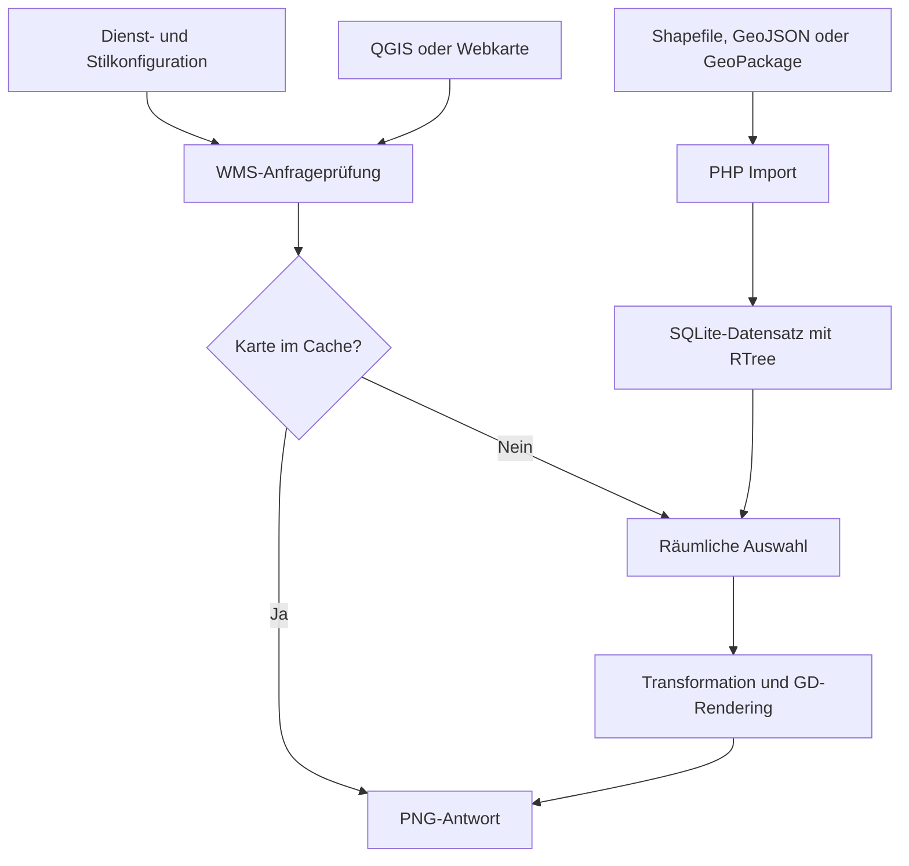

# Pure PHP WMS

Konfigurationsgesteuerter **WMS 1.3.0** für Apache und PHP ab **8.2**, ohne MapServer, GDAL, Node.js oder Hintergrunddienst. Geometrien werden in PHP verarbeitet und mit GD als georeferenzierte PNG-Kartenausschnitte gerendert. Die Georeferenzierung ergibt sich WMS-üblich aus `CRS`, `BBOX`, `WIDTH` und `HEIGHT`; das PNG ist keine GeoTIFF-Datei.

**Start:** [INSTALLATION.md](INSTALLATION.md) · **Konfiguration:** [docs/KONFIGURATION.md](docs/KONFIGURATION.md) · **Prüfungen und Grenzen:** [docs/VALIDIERUNG.md](docs/VALIDIERUNG.md)

## Funktionsumfang

| Bereich | Unterstützung |
|---|---|
| Eingaben | ESRI Shapefile mit DBF, GeoJSON FeatureCollection, GeoPackage-Vektortabellen |
| Geometrien | Punkte, Linien, Polygone mit Löchern, Multi-Geometrien, GeoJSON/GeoPackage GeometryCollection |
| Höhen/Messwerte | Z/M werden bei unterstützten Standardgeometrien eingelesen; Darstellung ist zweidimensional |
| WMS | GetCapabilities, GetMap, GetFeatureInfo; ausschließlich Version 1.3.0 |
| Zusätzliche Operation | GetLegendGraphic für konfigurierte Stile; begrenzte Erweiterung, kein vollständiger SLD-Server |
| Karten | PNG, Transparenz, Hintergrundfarbe, mehrere Layer in angegebener Zeichenreihenfolge |
| Objektabfrage | JSON/GeoJSON oder Klartext; konfigurierbare Freigabe einzelner Attributfelder |
| Stile | Füll- und Linienfarbe, Deckkraft, Linienbreite, Kreis/Quadrat/Dreieck/Raute/Kreuz, eigene PNG-Symbole |
| Beschriftung | Eigene TrueType-Schriften, Umlaute, Größe, Farbe, Halo, Kollisionsprüfung, Maßstabsgrenzen |
| Klassifikation | Erste passende Attributregel überschreibt den Basisstil |
| Koordinatensysteme | EPSG:4326, CRS:84, EPSG:3857, ETRS89/UTM EPSG:25832 und EPSG:25833 |
| Verwaltung | JSON-Dateien je Dienst/Stil, getrennte Datenquellen, Validierung und Importwerkzeug |
| Betrieb | SQLite-RTree-Index, begrenzter Dateicache, ETag, gleichzeitige Renderjobs begrenzt, Anfragebudgets |

**Bewusste Grenzen:** Keine GeoTIFF-/Rasterlayer, keine entfernten Datenquellen, keine SLD-Uploads, kein WFS/WMTS, keine Kurvengeometrien, kein Antimeridian- oder Polargebietbetrieb. Gültige Daten innerhalb ±85,05112878° Breite vorausgesetzt. Shapefile-Import maximal 16 MiB SHP-Datei und zusätzlich vom verfügbaren PHP-Speicher begrenzt. Für größere Bestände GeoJSON verwenden oder im GIS aufteilen. Der Dienst ist für regionale Vektorkarten mit begrenzter Komplexität ausgelegt.

Die Anwendung enthält geprüfte Betriebsmechanismen und automatisierte Tests. Sie ist **nicht OGC-zertifiziert**; ein vollständiger OGC-CITE-Konformitätslauf, QGIS-Integrationstest und Lasttest auf dem Zielhosting sind nicht Bestandteil der bisherigen Validierung. Der überprüfte Umfang ist in `docs/VALIDIERUNG.md` beschrieben.

## Laufzeitvoraussetzungen

- PHP **8.2 oder neuer**, 64 Bit; für neue Installationen eine vom Hoster gepflegte PHP-Version wählen.
- Standarderweiterungen `gd` **mit FreeType**, `pdo_sqlite` mit SQLite-RTree, `xmlwriter`, `mbstring`, `iconv`.
- Apache 2.4. Bei Ablage unterhalb des Webroots muss Apache die mitgelieferten `.htaccess`-Dateien auswerten.
- Empfehlung: `memory_limit=256M`, `max_execution_time` mindestens 20 Sekunden für Karten. Importe lokal ausführen; größere Importe können mehr Speicher benötigen.
- Keine `exec`-/`shell_exec`-/FFI-Aufrufe, kein externes Kartenprogramm, kein Datenbankserver.

Das Downloadpaket enthält `vendor/` und vorbereitete Beispieldaten. **Auf dem Hosting muss Composer nicht installiert sein.** Composer wird nur beim Aufbau des Pakets aus dem Quellcode bzw. beim Aktualisieren der Abhängigkeiten benötigt.

## Architektur



Importe erzeugen eine **neue Datei**, prüfen die Inhalte und veröffentlichen sie erst nach Erfolg. Ein gescheiterter Import ersetzt den bisherigen Datensatz nicht. Laufende Kartenanfragen lesen den veröffentlichten Datensatz nur. Jede Importgeneration besitzt eine neue Revision, die in den Cache-Schlüssel einfließt. Auch Stil- und Symboländerungen ändern den Cache-Schlüssel.

Die Daten werden für den Index in EPSG:4326 normalisiert. Geometriekanten werden zwischen ihren Stützpunkten gezeichnet. Sehr lange, schwach gestützte Linien oder Kanten deshalb vorab im GIS verdichten; eine automatische geodätische Kanteninterpolation ist nicht implementiert. Die ETRS89/WGS84-Transformation ist für Kartendarstellung gedacht, nicht für vermessungstechnische Genauigkeit oder epochengenaue Transformationen.

## Dienst aufrufen

QGIS-Verbindungs-URL:

```text
https://example.org/wms/public/wms.php?MAP=demo
```

Dienstbeschreibung:

```text
https://example.org/wms/public/wms.php?MAP=demo&SERVICE=WMS&VERSION=1.3.0&REQUEST=GetCapabilities
```

Beispielkarte:

```text
https://example.org/wms/public/wms.php?MAP=demo&SERVICE=WMS&VERSION=1.3.0&REQUEST=GetMap&LAYERS=land,routes,places&STYLES=&CRS=CRS:84&BBOX=11.28,48.18,11.39,48.245&WIDTH=1000&HEIGHT=700&FORMAT=image/png&TRANSPARENT=TRUE
```

`EPSG:4326` verwendet bei WMS 1.3.0 **Breite,Länge** für die BBOX. `CRS:84` verwendet **Länge,Breite**. Beispielsweise ist obige BBOX bei `EPSG:4326` als `48.18,11.28,48.245,11.39` zu übergeben. Webkarten können EPSG:3857 verwenden; QGIS kann die verfügbaren CRS aus den Capabilities auslesen.

## Bibliotheken

| Paket | Aufgabe |
|---|---|
| `phpmyadmin/shapefile` | Geometrien aus ESRI-Shapefiles lesen |
| `proj4php/proj4php` | Koordinatentransformationen in PHP |
| `halaxa/json-machine` | GeoJSON-Features sequenziell lesen |

Die DBF-Attributanbindung benötigt kein `dbase`-Modul. Der kleine eigene Decoder unterstützt einfache DBF-Felder `C`, `N`, `F`, `D`, `L`. Memo-/Binärfelder müssen im GIS vorab entfernt oder umgewandelt werden. DBF-Zahlen werden als Fließkommazahl behandelt; sehr lange Identifikatoren als Text exportieren.

Bibliotheksversionen stehen in `composer.lock`; alle Lizenzen werden mitgeliefert. Das Projekt wird unter **GPL-3.0-or-later** bereitgestellt, die gebündelten Bibliotheken und Schriften unter ihren jeweiligen Lizenzen.

## Entwicklung und Tests

```sh
composer install --no-dev --prefer-dist
php bin/console.php doctor
php bin/console.php validate
php bin/console.php import --all
composer test
```

Optional mit Python 3 für echte HTTP-Anfragen an den lokalen PHP-Testserver:

```sh
python tests/http_smoke.py php
```

Der PHP-Testserver ist nur für die lokale Prüfung vorgesehen. Im Produktivbetrieb übernimmt Apache die HTTP-Auslieferung. Der Anwendungscode liegt in getrennten Klassen für Protokoll, Datenimport, Indexzugriff, Geometrien, Rendering und Cache.

Die [OGC-Referenzprüfung](docs/OGC_REFERENZPRUEFUNG.md) dokumentiert Protokollkorrekturen, Testnachweise und noch offene Freigabeschritte.
